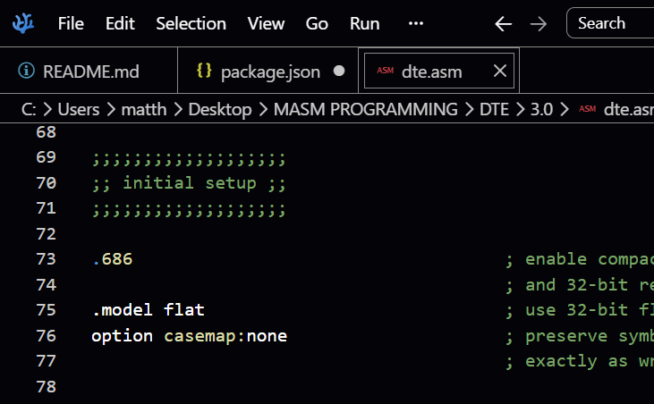
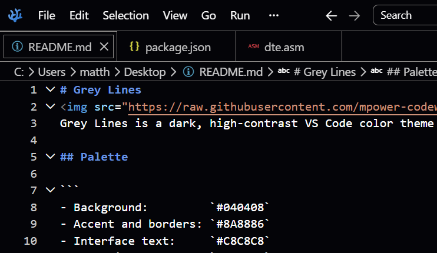

<!--
Grey Lines is a dark, high-contrast VS Code color theme
using near-black surfaces and medium grey borders.
-->
𝖦𝗋𝖾𝗒 𝖫𝗂𝗇𝖾𝗌 𝗂𝗌 𝖺 𝖽𝖺𝗋𝗄, 𝗁𝗂𝗀𝗁-𝖼𝗈𝗇𝗍𝗋𝖺𝗌𝗍 𝖵𝖲 𝖢𝗈𝖽𝖾 𝖼𝗈𝗅𝗈𝗋 𝗍𝗁𝖾𝗆𝖾
𝗎𝗌𝗂𝗇𝗀 𝗇𝖾𝖺𝗋-𝖻𝗅𝖺𝖼𝗄 𝗌𝗎𝗋𝖿𝖺𝖼𝖾𝗌 𝖺𝗇𝖽 𝗆𝖾𝖽𝗂𝗎𝗆 𝗀𝗋𝖾𝗒 𝖻𝗈𝗋𝖽𝖾𝗋𝗌.

<!--
Its syntax colors are based on VS Code's built-in
**Default High Contrast** theme.
-->
𝖨𝗍𝗌 𝗌𝗒𝗇𝗍𝖺𝗑 𝖼𝗈𝗅𝗈𝗋𝗌 𝖺𝗋𝖾 𝖻𝖺𝗌𝖾𝖽 𝗈𝗇 𝖵𝖲 𝖢𝗈𝖽𝖾'𝗌 𝖻𝗎𝗂𝗅𝗍-𝗂𝗇
𝖣𝖾𝖿𝖺𝗎𝗅𝗍 𝖧𝗂𝗀𝗁 𝖢𝗈𝗇𝗍𝗋𝖺𝗌𝗍 𝗍𝗁𝖾𝗆𝖾.
<br><br>
𝖲𝖾𝖾 "𝖱𝖾𝗅𝖾𝖺𝗌𝖾𝗌" 𝗈𝗇 𝗍𝗁𝖾 𝗋𝗂𝗀𝗁𝗍 𝖿𝗈𝗋 𝗍𝗁𝖾 𝖻𝗂𝗇𝖺𝗋𝗒.
<br><br>

## Palette

```
- Background:         `#040408`
- Accent and borders: `#8A8886`
- Interface text:     `#C8C8C8`
- Selection:          `#324A76`
- Scrollbar:          `#2A2A2E`
```

## Screenshots

<table>
    <tr>
        <td align="left" width="50%" valign="top">
            <br>
        </td>
        <td align="left" width="50%" valign="top">
            <br>
        </td>
    </tr>
    <tr>
        <td align="left" width="50%" valign="top">
            <br>
        </td>
        <td align="left" width="50%" valign="top">
            <br>
        </td>
    </tr>
</table>

Its syntax colors are based on VS Code's built-in **Default High Contrast** theme.

## Attribution

The original syntax-color rules were taken from Microsoft's VS Code *Default High Contrast* theme `hc_black.json`, distributed under the MIT License. See `THIRD_PARTY_NOTICES.md`.

## ⓜⓟⓞⓦⓔⓡ-ⓒⓞⓓⓔⓦⓞⓡⓚⓢ
