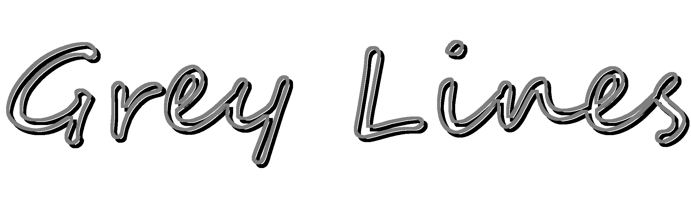
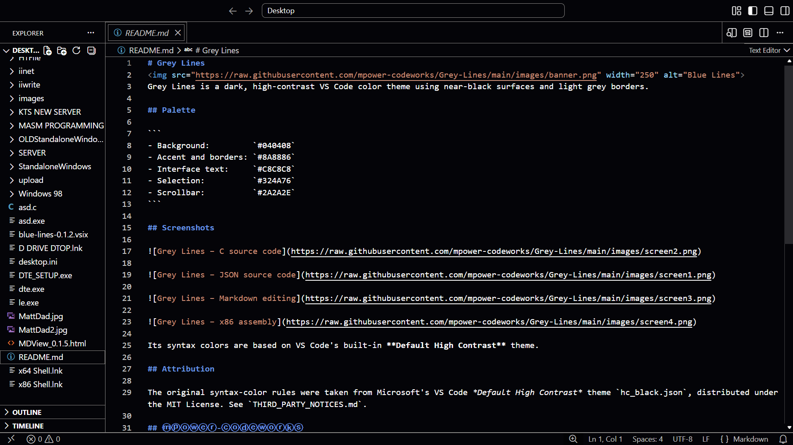
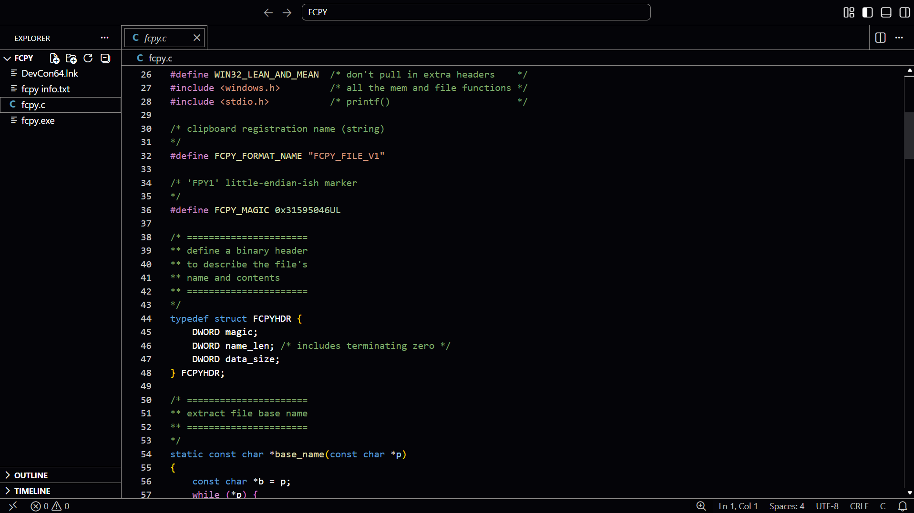

Grey Lines is a dark, high-contrast VS Code color theme using near-black surfaces and medium grey borders.

## Palette

```
- Background:         `#040408`
- Accent and borders: `#8A8886`
- Interface text:     `#C8C8C8`
- Selection:          `#324A76`
- Scrollbar:          `#2A2A2E`
```

## Screenshots






Its syntax colors are based on VS Code's built-in **Default High Contrast** theme.

## Attribution

The original syntax-color rules were taken from Microsoft's VS Code *Default High Contrast* theme `hc_black.json`, distributed under the MIT License. See `THIRD_PARTY_NOTICES.md`.

## ⓜⓟⓞⓦⓔⓡ-ⓒⓞⓓⓔⓦⓞⓡⓚⓢ
